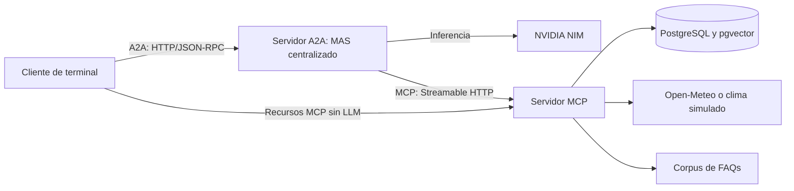

# Parachute S.A. — MCP y A2A

Sistema multiagente para consultas institucionales, evaluación meteorológica y reservas de paracaidismo. Integra un servidor MCP de herramientas, un agente público A2A y un cliente de terminal.

## Arquitectura



El servidor A2A expone un único agente con tres skills: preguntas frecuentes, clima y seguridad, y gestión de reservas. El MAS utiliza un orquestador central que delega mediante `as_tool()` en tres especialistas; cada uno accede únicamente a las herramientas MCP de su dominio.

| Especialista | Herramientas MCP |
| --- | --- |
| FAQs | `buscar_faqs` |
| Clima y seguridad | `resolver_fecha`, `consultar_clima`, `evaluar_condiciones` |
| Agenda | `consultar_disponibilidad`, `agendar_cita`, `listar_citas` |

Las FAQs se recuperan mediante embeddings de 384 dimensiones y búsqueda vectorial. La seguridad se evalúa con reglas deterministas; las reservas requieren evidencia meteorológica válida y respetan restricciones de fecha, horario, cupo e idempotencia.

| Interfaz | Dirección predeterminada |
| --- | --- |
| MCP Streamable HTTP | `http://127.0.0.1:8001/mcp` |
| A2A 1.0, JSON-RPC, sin streaming | `http://127.0.0.1:8000/` |
| Agent Card | `http://127.0.0.1:8000/.well-known/agent-card.json` |

A2A conserva el historial por `context_id` y serializa los turnos de una misma conversación. Cada turno genera una tarea; una reserva confirmada incorpora el comprobante original de MCP como artefacto separado. Los logs registran estado, duración e identificadores de solicitud para correlacionar ambos servidores.

## Instalación

Requisitos: `uv`, Python 3.12 administrado por `uv` y Docker Compose.

```bash
uv sync
cp -n .env.example .env
```

Configura `NVIDIA_API_KEY` en `.env` y verifica que `DATABASE_URL` corresponda a las variables `POSTGRES_*`. La copia no sobrescribe un `.env` existente. No publiques este archivo.

Prepara PostgreSQL, el corpus y la tabla de reservas:

```bash
docker compose up -d
docker compose ps
uv run python main.py load
uv run python -c 'from core.persistence import inicializar_esquema; inicializar_esquema()'
```

Espera a que PostgreSQL esté disponible antes de cargar los datos. `load` crea la extensión `vector` y carga las 120 FAQs; la inicialización de agenda crea su tabla si no existe. La primera carga descarga el modelo de embeddings y requiere conexión a internet y espacio disponible.

## Ejecución

Inicia los procesos en este orden, cada uno en una terminal independiente:

```bash
# 1. Herramientas: clima real y fecha actual de Guatemala
uv run python main.py mcp-server

# 2. Sistema multiagente
uv run python main.py a2a-server

# 3. Cliente remoto
uv run python main.py chat
```

Para reproducir las fechas históricas del evento, sustituye el primer comando por:

```bash
uv run python main.py mcp-server --mock-clima ideal --fecha-base 2026-09-18
```

Los escenarios disponibles son `ideal`, `marginal` y `prohibido`. `--fecha-base` exige simulación; el cliente y el modelo no pueden cambiar el escenario fijado por el servidor.

Ambos servidores admiten `--puerto`. A2A acepta `--mcp-url` y `--modelo`; el cliente acepta `--a2a-url` y `--mcp-url` para conectarse a direcciones distintas.

### Comandos del cliente

| Entrada | Operación |
| --- | --- |
| Mensaje de texto | Nueva tarea A2A en la conversación actual |
| `/nuevo` | Nueva conversación, sin eliminar reservas |
| `/recursos` | Listado de recursos MCP |
| `/recurso parachute://faqs/corpus` | Lectura del corpus sin inferencia ni búsqueda vectorial |
| `/ayuda` | Ayuda de comandos |
| `/salir` | Cierre del cliente |

Ejemplos para la configuración simulada anterior:

```text
¿Cuál es el peso máximo permitido para saltar? Cita la FAQ consultada.
¿Es seguro saltar el 2026-09-29? Consulta el clima y evalúa las condiciones.
```

## Verificación

Con PostgreSQL activo:

```bash
uv run python -m pytest -q tests/ evals/test_providers.py
```

Las pruebas de protocolos utilizan HTTP real, respuestas LLM simuladas y tablas PostgreSQL aisladas. Cubren herramientas, filtros por especialista, historial, concurrencia, comprobantes, recursos, errores de transporte y cierre de conexiones. Las comprobaciones manuales con NVIDIA consumen llamadas al proveedor.

## Compatibilidad y documentación

Las arquitecturas locales de las hojas anteriores permanecen disponibles:

```bash
uv run python main.py chat-local --arquitectura centralizada
uv run python main.py chat-local --arquitectura jerarquica
uv run python main.py chat-local --arquitectura descentralizada
```

`chat-local` admite `--modelo`, `--mock-clima` y `--fecha-base`. También se conservan `main.py smoke-test` y `main.py benchmark` mediante `uv run python`. Las evaluaciones históricas de Promptfoo requieren Node.js y se ejecutan con `npm ci` y `npm run eval:ci`.

- [Diseño de MCP y A2A](docs/diseno_mcp_a2a.md).
- [Informe de orquestación](docs/Hoja%20de%20trabajo%205%20-%20Orquestaci%C3%B3n.pdf).
- [Configuración de evaluaciones](evals/promptfooconfig.yaml) y [reporte histórico](evals/results/promptfoo.json).

## Límites conocidos

- Los servidores están limitados a localhost, sin autenticación adicional ni despliegue público.
- El historial y las tareas se pierden al reiniciar A2A; las evidencias meteorológicas se pierden al reiniciar MCP. Las reservas permanecen en PostgreSQL.
- El cliente espera hasta 180 segundos por respuesta. Un timeout no revierte una reserva ni provoca un reintento automático; consulta las citas antes de repetirla.
- Una tarea `COMPLETED` indica que el turno terminó, no que una reserva fue aprobada.
- El recurso del corpus es de solo lectura; no se publican prompts MCP. El corpus histórico conserva 106 respuestas genéricas.
