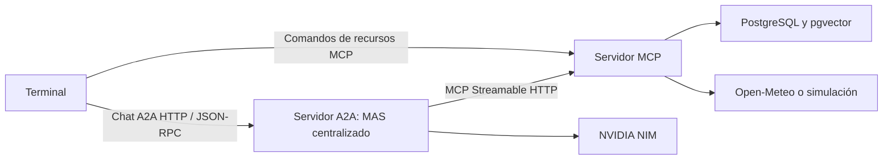

# Diseño de la HDT: MCP y A2A

## Objetivo y arquitectura acordada

Exponer las herramientas del sistema de Parachute S.A. mediante un único servidor
MCP con transporte Streamable HTTP y presentar el MAS centralizado como un solo
agente A2A. El desarrollo se revisará por hitos, con commits atómicos por
responsabilidad y una explicación de los cambios y sus pruebas en cada revisión.



Se ejecutarán tres procesos en terminales separadas. PostgreSQL conserva su
contenedor actual. Los servidores escucharán en localhost:

| Componente | Dirección predeterminada | Responsabilidad |
| --- | --- | --- |
| MCP | `http://127.0.0.1:8001/mcp` | Herramientas, corpus y evidencia meteorológica |
| A2A | `http://127.0.0.1:8000` | Orquestación, historial y resultados |
| Terminal | Cliente A2A y MCP | Chat y lectura explícita de recursos |

Se utilizarán los SDK oficiales de Python: MCP 2.x, OpenAI Agents y A2A 1.x,
con Starlette y Uvicorn. Las dependencias directas se declararán en
`pyproject.toml` y sus versiones resueltas se fijarán en `uv.lock`.

## Servidor MCP

Reutilizar las funciones y servicios actuales, conservando nombres y resultados
de negocio. Cada especialista verá únicamente las herramientas de su dominio:

| Especialista | Herramientas |
| --- | --- |
| FAQs | `buscar_faqs` |
| Clima y seguridad | `resolver_fecha`, `consultar_clima`, `evaluar_condiciones` |
| Agenda | `consultar_disponibilidad`, `agendar_cita`, `listar_citas` |

- Publicar el corpus existente como recurso de solo lectura
  `parachute://faqs/corpus`, de tipo `text/plain`. No publicar prompts MCP.
- Elegir clima real o simulado al iniciar MCP. El modelo no podrá elegir el modo
  de simulación ni la arquitectura que se registra en la reserva.
- Mantener las evidencias en memoria de un único proceso MCP. Reiniciar el
  servidor obliga a consultar nuevamente el clima para obtener evidencia válida.
- Usar la fecha actual de Guatemala por defecto. Aceptar `--fecha-base` junto con
  clima simulado para demostraciones históricas. Las pruebas y evals inyectarán
  explícitamente su referencia histórica.
- MCP no requiere credenciales LLM. Validarlas al crear el cliente del modelo.
- Registrar nombre, duración y resultado de cada herramienta: completada,
  rechazada por reglas o fallida. Excluir credenciales y argumentos personales
  completos de los logs.
- Conservar las validaciones deterministas de evidencia, fecha, horario,
  seguridad, cupo e idempotencia.

## Servidor A2A

Publicar un único agente, «Asistente Parachute S.A.», con Agent Card en
`/.well-known/agent-card.json` y tres skills públicas: preguntas frecuentes,
clima y seguridad, y gestión de reservas. Las skills describen capacidades;
el orquestador conserva sus tres delegaciones mediante `as_tool()`.

- Utilizar A2A 1.0 sobre HTTP/JSON-RPC, con entrada y salida de texto y respuesta
  completa, sin streaming.
- Cada turno produce una tarea completada o fallida. Un fallo de transporte se
  comunica como fallo operativo; no reintentar automáticamente una reserva cuyo
  resultado sea incierto.
- Conservar historial por `context_id` en memoria. Serializar turnos de una misma
  conversación para evitar mezclar su historial.
- Mantener cliente LLM y conexión MCP en un único ciclo de vida asíncrono y
  cerrarlos al detener el servidor.
- Obtener el comprobante exacto del resultado MCP de `agendar_cita` mediante
  hooks del SDK, conectados también al especialista. Enviarlo como artefacto A2A
  separado del texto del asistente, sin depender de una variable global local.
- Registrar inicio, final, duración y errores con identificadores de contexto y
  tarea. Propagar el identificador de solicitud a MCP mediante metadatos.

## Terminal y compatibilidad

```bash
uv run python main.py mcp-server
uv run python main.py a2a-server
uv run python main.py chat
uv run python main.py chat-local --arquitectura centralizada
```

- `chat` descubre la Agent Card y utiliza el cliente oficial A2A. Muestra la
  respuesta y, cuando exista, el comprobante.
- `/nuevo` comienza otra conversación; `/recursos` lista recursos MCP y
  `/recurso URI` lee el solicitado. Los comandos de recursos no usan el LLM.
- `chat-local` conserva las tres arquitecturas y aplica las opciones de modelo
  y simulación. Se mantienen `load`, `smoke-test`, `benchmark` y evals locales,
  ajustándolos cuando cambie código compartido.
- Importar por comando para que el cliente no construya agentes ni servicios
  locales de base de datos.

## Hitos y comprobaciones

| Hito | Responsabilidades separables |
| --- | --- |
| 1. Preparación | Instalar ponytail, guardar el diseño y aislar pruebas de citas |
| 2. Configuración | Corregir reloj y simulación, separar credenciales y declarar dependencias |
| 3. MCP | Publicar herramientas con logs y el recurso del corpus |
| 4. MAS remoto | Conectar especialistas con filtros y gestionar comprobantes y conexiones |
| 5. A2A | Publicar agente y skills, incorporar historial y artefactos |
| 6. Terminal y entrega | Convertir el chat, añadir comandos de recursos y documentar ejecución y video |

Cada hito puede contener varios commits, cada uno con una sola responsabilidad y
sus pruebas pertinentes. Al terminar el hito se explicará lo implementado y se
esperará la revisión del usuario antes de avanzar. Los commits serán de una línea
en español, Conventional Commits sin scope, cuerpo ni atribuciones a asistentes,
con autor `sallco <dcalderon918@gmail.com>` y respetando la configuración global.

Antes de ejecutar la suite completa, sustituir la limpieza de citas por nombre
por tablas de prueba propias. Verificar:

- Regresiones de fechas, seguridad, reservas, concurrencia e idempotencia.
- HTTP MCP real: siete herramientas, filtros, contratos, errores y corpus.
- HTTP A2A real con LLM simulado: Agent Card, skills, respuesta, historial y
  aislamiento entre conversaciones.
- Comprobante idéntico al devuelto por MCP.
- Clima ideal, marginal y prohibido; evidencia inexistente, fecha discordante y
  franja ocupada.
- Caída de MCP, pérdida de evidencias al reiniciar y cierre de conexiones.
- Acceso explícito a recursos sin inferencia LLM.

Cerrar con una demostración manual con NVIDIA y PostgreSQL reales y un guion de
video: tres terminales, FAQ con referencia, reserva con comprobante, rechazo por
seguridad y lectura del recurso. El usuario grabará el video siguiendo el guion.

## Límites y fuentes

Se conserva el corpus histórico: 120 FAQs, de las cuales 106 contienen respuestas
genéricas. La demostración RAG utilizará preguntas con respuestas concretas.
Conversaciones y evidencias se pierden al reiniciar sus servidores. No se incluye
despliegue público, autenticación adicional, persistencia de conversaciones ni
streaming A2A.

- [Construir un servidor MCP](https://modelcontextprotocol.io/docs/2026-07-28/develop/build-server).
- [SDK oficial MCP de Python](https://github.com/modelcontextprotocol/python-sdk).
- [Cliente MCP con OpenAI Agents](https://openai.github.io/openai-agents-python/mcp/).
- [SDK oficial A2A de Python](https://github.com/a2aproject/a2a-python).
- [Cliente A2A de Python](https://a2a-protocol.org/latest/tutorials/python/6-interact-with-server/).
